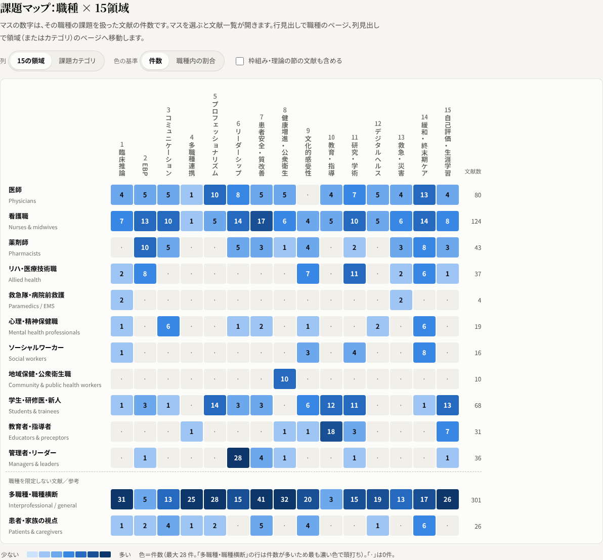

# 医療現場の課題マップ

*Clinical Challenges Map — an interactive map of the challenges health professionals report in clinical practice, by profession × 15 shared competency domains. Available in Japanese, English, Korean and Chinese.*

**どの職種が、どんな課題を感じているのか** ― 医師・看護職・薬剤師・リハビリ職などの医療専門職が臨床現場で直面している課題を、職種横断の15のコンピテンシー領域に整理した文献から可視化するWebアプリです。



- **課題マップ**：職種 × 15領域（または職種 × 課題カテゴリ）のヒートマップ。マスを選ぶと該当文献の一覧が開きます
- **職種から見る**：職種ごとに多く報告されている課題、領域別の分布、文献一覧
- **領域から見る**：15領域それぞれの概要、付録Hの節構成、職種別の分布
- **文献を探す**：キーワード・領域・職種・課題カテゴリで絞り込み、CSV（Excel対応）で保存
- 書誌の表記に崩れがありそうな文献や、同じタイトルで著者・年が異なる書誌には ⚠ を表示
- **日本語・English・한국어・中文** の4言語に対応（画面右上で切り替え）

## 表示言語

画面右上のボタンで切り替えられます。URL に `?lang=` を付けると、その言語で開くリンクになります。

| 言語 | URLの例 |
|---|---|
| 日本語 | `https://hm-cmed.github.io/ClinicalDifficulties/?lang=ja` |
| English | `https://hm-cmed.github.io/ClinicalDifficulties/?lang=en` |
| 한국어 | `https://hm-cmed.github.io/ClinicalDifficulties/?lang=ko` |
| 中文（简体） | `https://hm-cmed.github.io/ClinicalDifficulties/?lang=zh` |

`?lang=` がない場合は、前回選んだ言語 → ブラウザの言語設定の順に決まります（いずれも該当しなければ英語）。文献の書誌（タイトル・著者・雑誌名）は原文の英語のまま表示し、検索も英語で行います。

- 画面の文言・「このアプリについて」の本文：`assets/js/i18n.js`
- 職種・課題カテゴリ・15領域の名称と説明：`assets/js/taxonomy.js`
- 付録Hの見出し（15領域・小見出し）：`assets/js/appendix-h.js` の見出し行（`英 || 日本語 || 한국어 || 中文`）

韓国語・中国語の見出しと説明は本アプリ用に訳したものです。用語を各国の慣例に合わせたい場合は、上記ファイルの該当箇所を直接編集してください。

## データの出典

Hiroshi Mihara, *Designing AI-Driven Medical Education*（Cambridge Scholars Publishing, 刊行準備中）

- Appendix F: A Human-in-the-Loop AI Methodology for Identifying Clinical Competencies and Needs
- Appendix H: Domains of Clinical Reasoning and Reference List（15領域 × 721行 → 重複統合後 712件）

職種タグと課題カテゴリは、文献タイトルと付録Hの小見出しへのキーワード照合で自動付与しています。本文の対象者や結果を確認したものではありません。

**公開ページ：https://hm-cmed.github.io/ClinicalDifficulties/**

## 手元で開く

フォルダ内の `index.html` をダブルクリックするだけで動きます（サーバー不要・ビルド不要）。

## GitHub Pages で公開する（Windows / PowerShell）

1. GitHub で新しいリポジトリを作成します（例：`clinical-challenges-map`、Public、README等は追加しない）。
2. このフォルダで PowerShell を開き、次を実行します（`<ユーザー名>` は置き換え）。

   ```powershell
   git init
   git add .
   git commit -m "初版：医療現場の課題マップ"
   git branch -M main
   git remote add origin https://github.com/hm-cmed/ClinicalDifficulties.git
   git push -u origin main
   ```

3. リポジトリの **Settings → Pages** で、**Source: Deploy from a branch**、**Branch: `main` / `(root)`** を選んで Save。
4. 1〜2分後に `https://hm-cmed.github.io/ClinicalDifficulties/` で公開されます。

> ブラウザの **Add file → Upload files** でアップロードすると、フォルダ構成（`assets/js/`・`assets/css/`）が崩れて表示されなくなることがあります。更新は git で push するか、GitHub 上で個々のファイルを直接編集してください。
>
> すでに初版を公開済みの場合は、このフォルダの中身で上書きして `git add . ; git commit -m "4言語対応" ; git push` を実行してください。

## データの追加・修正

`assets/js/appendix-h.js` を編集して保存するだけで反映されます。書式はファイル冒頭のコメントを参照してください。

```
# 7 | Patient Safety and Quality Improvement || 患者安全と質改善 || 환자안전과 질 향상 || 患者安全与质量改进
## Moral Distress & Ethical Climate || 道徳的苦悩と倫理的風土 || 도덕적 고뇌와 윤리적 풍토 || 道德困扰与伦理氛围
Alimoradi, Z., E. Jafari, ... 2023. "Estimation of moral distress among nurses: ..." Nursing ethics 30(3) :334-357. https://doi.org/...
```

- `{core}` を付けた節は「枠組み・理論」として扱われ、既定では課題マップの件数から除外されます
- `{p:nurse}` はその節の全文献に職種タグを付与、`{f:phys,nurse}` はタイトルから職種が判定できない文献にだけ付与します

Node.js が入っていれば、件数や要確認の書誌を確認できます（任意）。

```powershell
node tools/check-data.mjs          # 件数の集計
node tools/check-data.mjs --list   # 要確認の書誌などを一覧
```

## 分類規則の調整

職種（13区分）と課題カテゴリ（19区分）のキーワードは `assets/js/taxonomy.js` に正規表現で定義しています。各言語の名称、15領域の説明・短縮名も同じファイルにあります。

## ファイル構成

```
index.html               画面
assets/css/style.css     デザイン（ライト／ダーク対応）
assets/js/appendix-h.js  文献データ（付録H。見出しは4言語）
assets/js/i18n.js        画面の文言（日本語・English・한국어・中文）
assets/js/taxonomy.js    職種・課題カテゴリ・領域説明の定義（4言語）
assets/js/model.js       書誌の解析・重複統合・タグ付け
assets/js/app.js         画面の描画
tools/check-data.mjs     データ点検スクリプト（任意）
.nojekyll                GitHub Pages の Jekyll 処理を無効化
```
